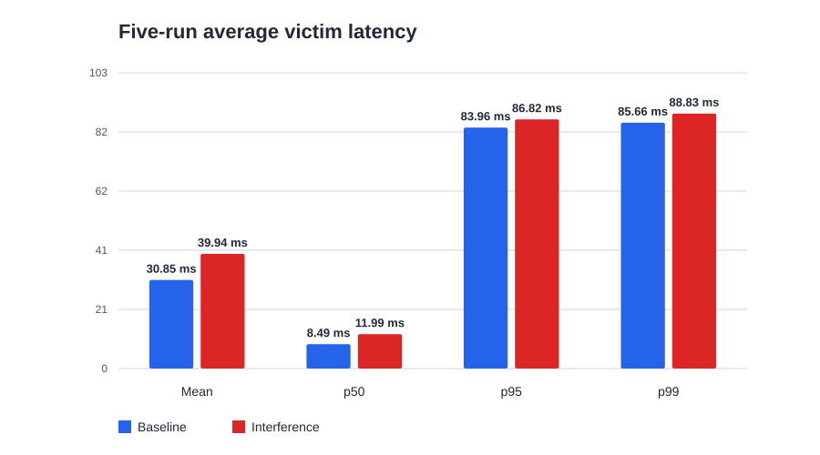
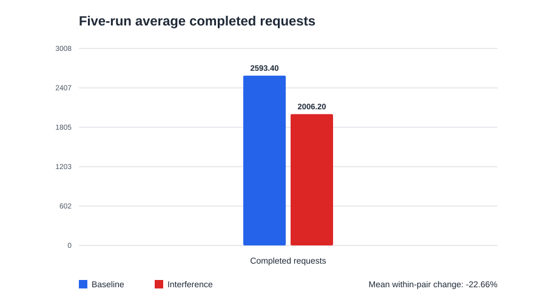

# CacheWarden

CacheWarden is an experimental systems-performance project that studies noisy-neighbor interference between containerized workloads sharing hardware.

## Current status

CacheWarden currently provides an **interference lab**, not a production observability or remediation system. Part 1 established repeatable application-level degradation, Part 2 used Linux `perf` and PMU counters to examine CPU execution, L3-cache behavior, and system-wide DRAM traffic, and Part 3 added paired eBPF measurements of scheduler run-queue delay. The repository implements a Go HTTP victim workload, a configurable Go aggressor workload, a concurrent Go HTTP load generator, Docker Compose configuration, an automated baseline-versus-interference benchmark, optional eBPF scheduler measurements, CSV output, summary statistics, tests, and CI-oriented build checks.

It does **not** implement automatic noisy-neighbor detection, cache-contention diagnosis, Kubernetes integration, anomaly detection, AI reporting, or remediation. Its eBPF support is deliberately limited to scheduler evidence for the benchmark victim.

## Key experimental finding

Across five controlled application runs, enabling the aggressor increased mean victim latency by approximately 29% and reduced completed requests by approximately 23%, while preliminary container-level observations showed similar victim CPU and memory utilization. In four later paired scheduler experiments, mean scheduler delay increased in every interference phase, by approximately 10% when comparing the arithmetic mean across conditions.

These experiments establish repeatable interference, not its root cause.

## Architecture

```text
                         GET /work
  tools/loadgen  ---------------------------->  victim
       |                                         |
       | writes latency CSV                      | scans a fixed in-memory data set
       v                                         v
    results/                              Prometheus /metrics

  aggressor (opt-in)  ---> sequential read/write pressure on shared memory hardware
```

The independent Go modules are coordinated by [`go.work`](go.work):

- `victim` exposes `/health`, `/work`, and `/metrics`.
- `aggressor` allocates a bounded buffer and runs sequential read/write workers.
- `tools/loadgen` records individual request results as CSV and reports mean, p50, p95, and p99 latency.

Architecture decisions are recorded in [`docs/adr`](docs/adr/README.md).

## Quick start

From the repository root:

```bash
make test
make run-victim
```

In a second terminal:

```bash
curl http://127.0.0.1:8080/health
curl http://127.0.0.1:8080/work
curl http://127.0.0.1:8080/metrics
```

Stop the foreground victim with `Ctrl+C`.

## Requirements

Local development requires Go 1.22+, GNU Make, Bash, and `curl`. Container experiments additionally require Docker Engine or Docker Desktop and Docker Compose v2. No external HTTP load generator is required.

To build and check every Go module:

```bash
make build
make test
make lint
make race
```

For container operation:

```bash
# Victim only
docker compose up --build victim

# Victim plus the opt-in aggressor
docker compose --profile interference up --build

docker compose --profile interference down --remove-orphans
```

The Compose services define CPU and memory limits. Runtime support for these settings varies; inspect the effective container configuration before relying on it, and do not treat Compose limits as Kubernetes resource guarantees.

## Workload configuration

Both programs accept command-line flags that override environment variables. Run `go run ./cmd/victim --help` inside `victim`, or `go run ./cmd/aggressor --help` inside `aggressor`, for the complete flag list.

| Victim environment variable | Default | Purpose |
| --- | ---: | --- |
| `VICTIM_LISTEN_ADDRESS` | `:8080` | HTTP listen address |
| `VICTIM_WORKLOAD_SIZE` | `32MiB` | Preallocated data-set size |
| `VICTIM_WORKLOAD_ITERATIONS` | `2` | Full scans per `/work` request |
| `VICTIM_SHUTDOWN_TIMEOUT` | `10s` | Graceful shutdown deadline |

| Aggressor environment variable | Default | Purpose |
| --- | ---: | --- |
| `AGGRESSOR_MODE` | `low` | `low`, `medium`, or `high` duty cycle |
| `AGGRESSOR_MEMORY` | `128MiB` | Total buffer size |
| `AGGRESSOR_WORKERS` | at most `2` | Concurrent memory workers |
| `AGGRESSOR_REPORT_INTERVAL` | `5s` | Throughput log interval |

For a deliberate local interference run:

```bash
AGGRESSOR_MODE=medium AGGRESSOR_MEMORY=256MiB make run-aggressor
```

## Reproducing the benchmark

Run:

```bash
make benchmark
```

The script checks prerequisites, starts the victim alone, records baseline traffic, enables the aggressor, records comparable interference traffic, and then removes its containers. Defaults are 20 seconds per phase with concurrency 4. The benchmark uses host port `18080` by default to avoid a local victim conflict.

```bash
BENCHMARK_DURATION=30s BENCHMARK_CONCURRENCY=8 make benchmark
```

Each run writes timestamped files without overwriting existing output:

```text
results/<timestamp>-baseline.csv
results/<timestamp>-interference.csv
results/<timestamp>-summary.txt
```

CSV rows contain a UTC start time, status code, latency in milliseconds, and any request error. The summary includes request totals, failures, mean, p50, p95, p99, and selected percentage changes.

### Optional eBPF scheduler measurements

The scheduler collector requires Linux with kernel BTF at `/sys/kernel/btf/vmlinux`, `clang`, `bpftool`, `pkg-config`, and the libbpf development package. On Ubuntu, install the build dependencies and compile with:

```bash
sudo apt-get update
sudo apt-get install -y clang bpftool libbpf-dev pkg-config
make ebpf
```

Loading and attaching BPF programs normally requires root, or an explicitly configured set of `CAP_BPF`, `CAP_PERFMON`, `CAP_SYS_RESOURCE`, and, on older kernels, possibly `CAP_SYS_ADMIN` capabilities. Kernel lockdown and `kernel.unprivileged_bpf_disabled` can impose additional restrictions. The simplest validation on a dedicated Ubuntu test host is:

```bash
sudo make benchmark-scheduler
```

`benchmark-scheduler` builds the collector and runs the normal benchmark with `ENABLE_SCHEDULER=1`. The script obtains the victim container's host init PID from Docker and continuously tracks all threads in the process tree below it, including the actual victim process behind Compose's init shim. A fresh collector is started immediately before each load phase and stopped before the next phase. Interrupt and error cleanup terminates the collector and Compose services.

The eBPF program records runnable timestamps from `sched_wakeup` and `sched_wakeup_new`, and from `sched_switch` when a tracked task is preempted or otherwise switched out while still runnable. On the next switch to that task, it subtracts the saved timestamp from `bpf_ktime_get_ns()`, deletes the timestamp, and updates the count, total, maximum, and log2 histogram. The shared counters and maximum use atomic operations. The maximum update uses a verifier-compatible bounded compare-and-swap retry; under sustained contention, exhausting the retries can cause `max_delay_ns` to under-report an observation rather than permit a non-atomic overwrite.

In addition to the normal files, a successful run creates:

```text
results/<timestamp>-baseline-scheduler.csv
results/<timestamp>-interference-scheduler.csv
```

The scheduler CSV schema is `metric,value,unit`. `schedule_ins` counts switches onto a CPU for tracked threads. `observed_delays` counts schedule-ins for which a runnable timestamp was available. `total_delay_ns` and `mean_delay_ns` describe time spent runnable but not executing. `p50_delay_upper_bound_ns`, `p95_delay_upper_bound_ns`, and `p99_delay_upper_bound_ns` are upper bounds from base-2 nanosecond histogram buckets, not exact quantiles; `max_delay_ns` is intended to track the largest observed delay, subject to the bounded-update limitation described below. Non-empty histogram rows contain per-bucket counts.

The scheduler data has several important limits: wakeups or preemptions that occur before a newly created thread is discovered can be missed; thread discovery is periodically synchronized rather than cgroup-native; percentile precision is limited by logarithmic buckets; and a measurement ending while a thread is still runnable has no completed delay to record. The tracepoints measure scheduler run-queue delay, not CPU time, cache misses, or the cause of application latency. Results are host- and kernel-specific.

## Part 1 — Reproducing noisy-neighbor interference

### Benchmark results

The reference dataset in [`docs/data/five-run-benchmark.csv`](docs/data/five-run-benchmark.csv) contains five independent runs using the same victim configuration, 20-second phases, concurrency 4, and zero failed requests. Baseline runs the victim without the aggressor; interference enables it.





| Run | Baseline requests | Interference requests | Baseline mean (ms) | Interference mean (ms) | Baseline p50 (ms) | Interference p50 (ms) | Baseline p95 (ms) | Interference p95 (ms) | Baseline p99 (ms) | Interference p99 (ms) |
| --- | ---: | ---: | ---: | ---: | ---: | ---: | ---: | ---: | ---: | ---: |
| 1 | 2,491 | 1,815 | 32.098 | 43.961 | 8.870 | 13.587 | 84.201 | 88.550 | 85.921 | 90.926 |
| 2 | 2,726 | 2,123 | 29.264 | 37.660 | 8.021 | 11.326 | 83.657 | 85.883 | 85.215 | 87.357 |
| 3 | 2,674 | 2,094 | 29.891 | 38.069 | 8.194 | 11.281 | 83.754 | 86.199 | 85.260 | 87.662 |
| 4 | 2,442 | 1,950 | 32.648 | 40.992 | 9.022 | 12.239 | 84.403 | 87.224 | 86.527 | 90.203 |
| 5 | 2,634 | 2,049 | 30.350 | 39.014 | 8.338 | 11.517 | 83.797 | 86.221 | 85.380 | 88.001 |

| Five-run average | Baseline | Interference | Change |
| --- | ---: | ---: | ---: |
| Mean latency | 30.85 ms | 39.94 ms | +29.42% |
| p50 latency | 8.49 ms | 11.99 ms | +41.17% |
| p95 latency | 83.96 ms | 86.82 ms | +3.40% |
| p99 latency | 85.66 ms | 88.83 ms | +3.69% |
| Completed requests | 2,593 | 2,006 | -22.66% |

All five runs had the same qualitative direction: latency increased and completed request count decreased. Failures were zero. These host- and configuration-specific measurements demonstrate repeatable degradation when the aggressor is active; they do not establish LLC/cache contention, memory-bandwidth saturation, or another single cause.

Regenerate the committed charts with only the Python standard library:

```bash
python3 tools/plot_results.py
```

## Why container-level metrics were insufficient

A preliminary `docker stats` observation recorded the following approximate snapshots:

| Phase / container | CPU | Memory |
| --- | ---: | ---: |
| Baseline victim | 103.58% | 40.28 MiB / 256 MiB |
| Interference victim | 104.11% | 41.15 MiB / 256 MiB |
| Aggressor during interference | 205.15% | 260.6 MiB / 512 MiB |

In this preliminary observation, victim application performance degraded while its conventional CPU and memory utilization remained broadly similar. This motivates investigation below ordinary container-level resource metrics. These snapshots are not rigorous proof, and Docker metrics remain useful inputs to an investigation.

## Part 2 — Low-level performance investigation

Part 2 used paired baseline/interference measurements to test whether the aggressor changed low-level execution and shared memory-subsystem behavior. These measurements narrow the investigation, but they do not by themselves identify a single root cause.

### CPU execution and IPC

A recent paired manual `perf` experiment produced the following measurements:

| Metric | Baseline | Interference | Approximate change |
| --- | ---: | ---: | ---: |
| task-clock | 9,979.85 ms | 9,994.61 ms | essentially unchanged |
| cycles | 41,526,308,835 | 37,582,130,258 | -9.5% |
| instructions | 119,969,148,554 | 102,537,856,119 | -14.5% |
| IPC | 2.89 | 2.73 | -5.6% |
| APERF / MPERF estimated frequency | 4.19 GHz | 3.78 GHz | -9.6% |

The frequency estimate uses APERF/MPERF and a 2.30 GHz nominal/base frequency; cycles per task-clock were approximately 4.16 GHz in the baseline. The victim received approximately the same CPU execution time in this paired run, so this measurement does not support simple scheduling starvation. The aggressor coincided with lower effective core frequency and a modest reduction in instructions retired per cycle. This does not prove that frequency behavior caused the application slowdown.

### L3-cache experiment

Three additional paired `perf` measurements collected `cycles`, `instructions`, `mem_load_retired.l3_hit`, `mem_load_retired.l3_miss`, and `cycle_activity.stalls_l3_miss`. The derived metrics are:

```text
IPC = instructions / cycles
L3 MPKI = L3 misses / instructions * 1000
L3 stall fraction = L3-miss stall cycles / cycles
```

The raw counter values were:

| Pair | Phase | Cycles | Instructions | L3 hits | L3 misses | L3-miss stall cycles |
| ---: | --- | ---: | ---: | ---: | ---: | ---: |
| 1 | Baseline | 39,401,527,525 | 112,642,239,906 | 1,747,143 | 1,152,812 | 409,145,575 |
| 1 | Interference | 36,969,713,464 | 101,089,744,690 | 1,717,490 | 1,119,679 | 432,080,042 |
| 2 | Baseline | 40,251,014,300 | 116,989,087,530 | 1,810,135 | 1,215,698 | 403,299,746 |
| 2 | Interference | 27,505,150,330 | 77,972,711,839 | 1,668,254 | 1,089,851 | 287,413,785 |
| 3 | Baseline | 39,658,072,097 | 114,999,430,347 | 1,780,220 | 1,167,341 | 411,717,149 |
| 3 | Interference | 32,146,670,325 | 91,688,360,061 | 1,704,588 | 1,006,876 | 321,098,347 |

Derived results and within-pair changes were:

| Pair | IPC baseline | IPC interference | IPC change | L3 MPKI baseline | L3 MPKI interference | MPKI change | Stall baseline | Stall interference | Stall change |
| ---: | ---: | ---: | ---: | ---: | ---: | ---: | ---: | ---: | ---: |
| 1 | 2.859 | 2.735 | -4.3% | 0.01023 | 0.01108 | +8.3% | 1.039% | 1.169% | +12.5% |
| 2 | 2.91 | 2.83 | -2.5% | 0.01039 | 0.01398 | +34.6% | 1.00% | 1.04% | +4.3% |
| 3 | 2.899 | 2.852 | -1.6% | 0.01015 | 0.01098 | +8.2% | 1.038% | 0.999% | -3.8% |

| Signal | Direction under interference | Consistency |
| --- | --- | --- |
| IPC | Decreased | 3 of 3 pairs |
| L3 MPKI | Increased | 3 of 3 pairs |
| L3-miss stall fraction | Increased twice, decreased once | Not consistent |

The aggressor therefore measurably changed the victim's execution and L3-cache behavior. The consistent IPC decrease and L3 MPKI increase are evidence of an association, but the inconsistent L3-miss stall fraction means these measurements do not establish L3 contention as the cause of the slowdown.

### DRAM / memory-controller experiment

The host exposes the uncore memory-controller events `unc_mc0_rdcas_count_freerun` and `unc_mc0_wrcas_count_freerun`. Each count represents one 64-byte DRAM transfer. A system-wide measurement during the controlled workload produced:

| Phase | Read requests | Write requests | Duration | Read bandwidth | Write bandwidth | Total bandwidth |
| --- | ---: | ---: | ---: | ---: | ---: | ---: |
| Baseline | 405,705,699 | 13,007,294 | ~10.0014 s | ~2.60 GB/s | ~0.083 GB/s | ~2.68 GB/s |
| Interference | 574,839,991 | 187,609,907 | ~10.0019 s | ~3.68 GB/s | ~1.20 GB/s | ~4.88 GB/s |

Total system-wide DRAM traffic increased from approximately 2.68 GB/s to 4.88 GB/s, an increase of approximately 82%. This establishes that enabling the aggressor created substantially more traffic at the shared memory controller during the measurement.

These are **system-wide uncore counters**, not victim-process counters. The 4.88 GB/s value must not be attributed entirely to the victim, and the measurement does not demonstrate DRAM bandwidth saturation, DRAM latency, or either one as the cause of the victim latency increase.

### PMU and TMA measurement limitations

The investigation also attempted to collect `tma_info_system_dram_bw_use`, `tma_dram_bound`, `tma_mem_bandwidth`, `tma_mem_latency`, and `tma_info_memory_load_miss_real_latency`. Although `perf list` exposed some of these metrics, `perf` could not evaluate them because required underlying events were unavailable on this system. Examples included:

- `UNC_ARB_TRK_REQUESTS.ALL`: not supported
- `UNC_ARB_COH_TRK_REQUESTS.ALL`: not supported
- `CYCLE_ACTIVITY.STALLS_L2_MISS`: unavailable
- `MEM_LOAD_RETIRED.FB_HIT`: unavailable

This is a host PMU/tooling limitation, not an application failure. It prevents this experiment from using those TMA metrics to distinguish bandwidth-bound from latency-bound behavior.

### What the measurements establish

| Supported by the measurements | Not established by the measurements |
| --- | --- |
| Repeatable application-level degradation | L3 contention as the root cause |
| Lower IPC in all three L3 pairs | DRAM bandwidth saturation |
| Higher L3 MPKI in all three L3 pairs | The victim consuming all measured DRAM traffic |
| Inconsistent L3-miss stall-fraction changes | DRAM latency as the root cause |
| Approximately 82% more system-wide DRAM traffic | CPU frequency as the root cause |

The Part 2 result is deliberately bounded: the aggressor measurably changes the victim's low-level execution behavior and substantially increases shared DRAM traffic. IPC decreased and L3 MPKI increased consistently across three paired measurements, while L3-miss-related stall behavior was inconsistent. The available evidence does not identify L3 contention, DRAM bandwidth saturation, memory latency, CPU frequency, or another single mechanism as the root cause of the application slowdown.

## Part 3 — eBPF scheduler observability

Part 3 adds operating-system-level evidence by measuring how long tracked victim threads remain runnable before executing. The benchmark attaches eBPF programs to scheduler wakeup and switch tracepoints, follows the victim container's host process tree, and collects one fresh measurement for each baseline and interference load phase. This measures scheduler run-queue delay for observed transitions; it does not measure CPU execution time, cache misses, or application latency directly.

### Paired scheduler results

Four paired experiments produced the following scheduler-delay means from the generated scheduler CSVs:

| Run ID | Baseline mean | Interference mean | Change |
| --- | ---: | ---: | ---: |
| `20261011T201551Z` | 4,829,080 ns | 5,241,832 ns | +8.55% |
| `20261012T113331Z` | 4,552,242 ns | 5,116,104 ns | +12.39% |
| `20261012T123202Z` | 4,749,082 ns | 5,339,204 ns | +12.43% |
| `20261012T123305Z` | 4,715,717 ns | 5,044,729 ns | +6.98% |
| Arithmetic mean across runs | 4,711,530 ns | 5,185,467 ns | +10.06% |

Each percentage is calculated within its baseline/interference pair. The final row first takes the unweighted arithmetic mean of the four reported baseline means and the four reported interference means, then calculates the percentage difference between those two condition means. It is not weighted by `observed_delays`; the average of the four within-pair percentage changes would instead be 10.08%.

Mean scheduler delay increased under interference in all four pairs. This is additional evidence that the victim's operating-system-level behavior changed when the aggressor was active, alongside the application-level latency and throughput changes from Part 1 and the CPU, cache, and memory-controller observations from Part 2.

### Histogram interpretation and consistency

All eight scheduler CSVs report a p50 upper bound of 4,095 ns and p95 and p99 upper bounds of 134,217,727 ns. These are upper bounds of base-2 nanosecond histogram buckets, not exact percentile values; in particular, 134,217,727 ns must not be read as a precise p95 or p99 scheduler delay. The combination of a microsecond-scale median upper bound and a millisecond-scale mean is consistent with a highly skewed distribution in which relatively rare, large delays raise the mean.

For the `20261011T201551Z` interference phase, `observed_delays` is 12,530 and the sum of all emitted histogram bucket counts is also 12,530. This establishes internal count consistency for that CSV, but it does not independently validate timestamp coverage or measurement accuracy.

### Interpretation and limitations

The scheduler evidence does not establish scheduling delay as the primary cause of the application slowdown. Similarly, the Part 2 increase in L3 MPKI does not independently prove L3 contention, and the system-wide DRAM-traffic increase does not prove bandwidth saturation. Taken together, the three parts demonstrate repeatable performance degradation accompanied by measurable changes at the application, CPU/cache/memory-controller, and scheduler levels, but they do not establish a definitive single root cause.

Scheduler-specific limitations include periodically discovered process-tree membership rather than cgroup-native tracking; missed wakeups or preemptions before a new thread is discovered; no completed delay for a task still runnable when collection stops; coarse percentile bounds from log2 buckets; and a bounded atomic maximum update that can under-report under sustained update contention. Results and percentages are specific to this host, configuration, synthetic workload, and measurement period, and should not be generalized to arbitrary systems or production workloads.

## Metrics and observability available today

`GET /metrics` exposes Prometheus text metrics:

- `cachewarden_http_requests_total`
- `cachewarden_http_request_duration_seconds`
- `cachewarden_work_duration_seconds`
- `cachewarden_http_errors_total`
- `cachewarden_http_active_requests`

Prometheus is not bundled; an existing instance can scrape the victim if time-series collection is needed. The benchmark additionally provides request-level CSV latency data, summary percentiles, and optional paired eBPF scheduler CSVs. PMU collection remains a manual investigation.

## Limitations

- The workloads are synthetic and results are host- and configuration-specific.
- Scheduler placement, NUMA topology, caches, memory channels, frequency scaling, thermal state, and background activity are not controlled by this experiment.
- The benchmark is closed-loop concurrency, not a fixed-rate arrival model.
- Process-local metrics reset on restart, and container resource controls vary by runtime and platform.
- The available measurements cannot distinguish among the remaining root-cause hypotheses.

## Project scope and summary

1. Part 1 established reproducible application-level degradation: higher latency and fewer completed requests under interference.
2. Part 2 established associated changes in CPU execution and L3 behavior, plus substantially higher system-wide DRAM traffic, without identifying a single causal mechanism.
3. Part 3 established higher mean scheduler delay in all four paired experiments, adding scheduler-level evidence without proving that scheduling is the primary cause.

Collectively, the three parts show that the controlled aggressor produces repeatable victim degradation accompanied by observable changes across several layers of the system. They support a structured performance investigation, not a definitive causal diagnosis.

**CacheWarden v1.0 is a reproducible performance investigation laboratory for containerized noisy-neighbor interference. It is not an automated root-cause diagnosis, anomaly detection, or remediation platform.** Kubernetes integration, automatic detection, and remediation are not implemented.

## Repository structure

```text
aggressor/       Configurable Go interference workload
victim/          Go HTTP service under test
tools/loadgen/   Concurrent Go HTTP load generator
scripts/         Benchmark automation
docs/adr/        Architecture decision records
docs/data/       Committed Part 1 reference dataset
docs/images/     Reproducible Part 1 result charts
results/         Timestamped local benchmark output
```

## Safety

The aggressor is a controlled experiment workload, not a denial-of-service or general-purpose stress-testing tool. Defaults are conservative; invalid modes, worker counts, and allocations above 1 GiB are rejected, and Linux additionally rejects requests above half of `MemAvailable`. The Compose aggressor has a 512 MiB memory limit and a 2.0 CPU limit, and is absent from the default profile.

Run experiments only on systems you own or are authorized to test. Avoid production nodes, shared development hosts, or systems already under memory pressure. OOM termination remains possible when runtime overhead and the configured buffer reach the effective limit.

## License

CacheWarden is available under the [MIT License](LICENSE).
